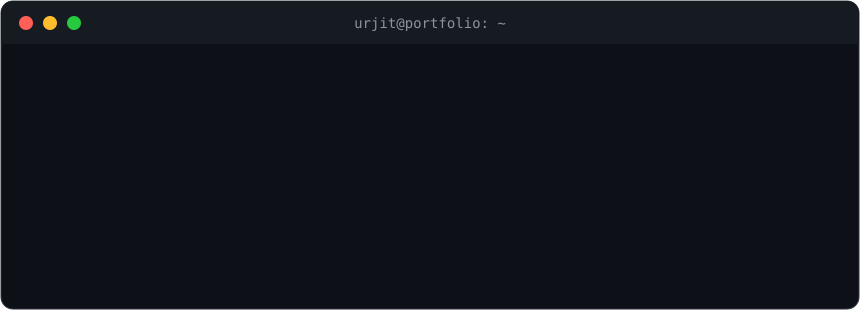
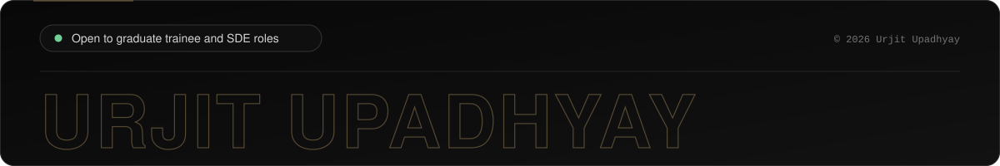

<div align="center">
  
</div>

<div align="center">
  
</div>

<br/>

<div align="center">
  <a href="https://urjit-upadhyay-portfolio-updated-d5.vercel.app/"></a>
  <a href="https://linkedin.com/in/urjit-upadhyay-049428236"></a>
  <a href="mailto:urjitupadhyayuu@gmail.com"></a>
  
</div>

<br/>

<div align="center">
  
</div>

<br/>

<div align="center">
  
</div>


## ⚡ Recruiter Quick View

| | |
|---|---|
| **Role** | Software Developer, GoStride Ventures (converted from intern to full-time) |
| **Education** | B.Tech Computer Engineering, Aligarh Muslim University (CPI 8.35/10). Diploma CGPA 9.97/10, University Rank 2 |
| **Core stack** | Python, FastAPI, React, TypeScript, Docker, PostgreSQL, MongoDB |
| **Also** | Flutter/Dart, Next.js, Solidity, applied ML and Generative AI |
| **Proof** | 7x hackathon winner, F1 0.943 ML system with 71 tests, ERP modules in production |
| **Certified** | Oracle Cloud Infrastructure (OCI) AI Foundations Associate |
| **Looking for** | Graduate Trainee / SDE roles |
| **Location** | Aligarh, Uttar Pradesh, India (open to relocation and remote) |


## 👋 About Me

I'm a Computer Engineering student who already ships production software for teams in **India, the UAE and Canada**. I build backend-heavy, AI-powered and cross-platform products, and I turn requirements into reliable, tested code quickly. One of my hackathon wins went from idea to deployed demo in **72 hours**.

- 💼 **Software Developer** at GoStride Ventures, building multi-tenant ERP modules
- 🏭 Interned at **NTPC Limited** (Corporate Centre) and built **SCADA** monitoring software at Temflo Systems
- 🏆 **7x Hackathon Winner**, including 1st place at **Slop Scan** and **Dreamware** ($1000)
- 🎓 **Workshop Lead** at GDGC ZHCET, teaching Flutter to fellow students
- ⚡ Off-screen: bike rides, nature escapes and clean code


## 💼 Experience

```text
 Jul 2026 ─► Present    Software Developer ... GoStride Ventures    (Dubai, UAE · Remote)
 Jun 2026 ─► Jul 2026   Software Dev Intern .. NTPC Limited         (New Delhi)
 Mar 2026 ─► Jun 2026   Software Dev Intern .. Second Plate Inc.    (Toronto, Canada · Remote)
 Dec 2025 ─► Feb 2026   SDE Intern ........... Temflo Systems       (Remote)
```

| Company | What I did |
|---|---|
| **GoStride Ventures** | Building enterprise ERP modules with FastAPI, Python, React and TypeScript for a multi-tenant SaaS platform. Docker-based microservices for authentication, billing and ERP workflows. |
| **NTPC Limited** | Worked under the DGM of IT at the Corporate Centre on enterprise IT systems, monitoring workflows and reliability operations in the power sector. |
| **Second Plate Inc.** | Shipped cross-platform features on REST APIs for a live food-redistribution platform. End-to-end debugging, QA and performance troubleshooting. |
| **Temflo Systems** | Built and maintained real-time SCADA-based industrial control and monitoring software, with testing, documentation and security practices. |


## 🛠️ Tech Stack

<div align="center">

**Languages**


**Backend and Data**


**Frontend and Mobile**


**Tools, Cloud and Web3**


</div>

<details>
<summary><b>📚 Full skill breakdown</b></summary>

- **AI / ML:** regression, classification, predictive analytics, feature analysis, Generative AI, LLM integration
- **Backend:** REST APIs, microservices, multi-tenant architecture, database design
- **Quality:** unit and integration testing, QA, debugging, technical documentation
- **CS fundamentals:** DSA, OOP, complexity analysis, SDLC
- **Ways of working:** agile workflows, teamwork, communication, workshop facilitation

</details>


## 🚀 Featured Projects

<table>
  <tr>
    <td width="50%" valign="top">
      <h3>🛡️ SlopGuard 🥇</h3>
      <p><b>Applied ML quality-detection system.</b> Scored an <b>F1 of 0.943</b> on 188 real GitHub pull requests, backed by <b>71 passing tests</b>. Data processing, inference API and UI delivered in <b>72 hours</b>.</p>
      <p><i>1st Place, Slop Scan Hackathon</i></p>
      
      
      
      
      <br/><a href="https://slopguard-six.vercel.app/">🔗 Live Demo</a>
    </td>
    <td width="50%" valign="top">
      <h3>🍽️ NextPlate 🥇</h3>
      <p><b>AI-powered food redistribution platform</b> connecting restaurants, NGOs and volunteers. Generative AI handles food classification and distribution matching.</p>
      <p><i>1st Place ($1000), Dreamware Hackathon</i></p>
      
      
      
      
      <br/><a href="https://next-plate-core-1dha-beryl.vercel.app/story.html">🔗 Live Demo</a>
    </td>
  </tr>
  <tr>
    <td width="50%" valign="top">
      <h3>🏢 Erpica</h3>
      <p><b>Enterprise ERP interface</b> covering HR, attendance, payroll, leave and the full employee lifecycle.</p>
      
      
      
    </td>
    <td width="50%" valign="top">
      <h3>🗳️ Evote</h3>
      <p><b>Tamper-resistant blockchain voting system</b> built on Solidity smart contracts and an immutable ledger, with a Flutter front end.</p>
      
      
      <br/><a href="https://github.com/urjitupadhya/online_voting_system">🔗 Source Code</a>
    </td>
  </tr>
</table>


## 🏆 Achievements

- 🥇 **7x Hackathon Winner**, including **1st Place at Slop Scan** and **1st Place at Dreamware ($1000)**
- 🎓 **Diploma CGPA 9.97/10**, University Rank 2 (University Polytechnic, AMU)
- ☁️ **Oracle Cloud Infrastructure (OCI) AI Foundations Associate** certified
- 🎤 **Workshop Lead**, running Flutter workshops at GDGC ZHCET


## 📊 GitHub Stats

<div align="center">
  
  
</div>

<div align="center">
  
  
</div>

<div align="center">
  
</div>

<br/>

<div align="center">
  <picture>
    <source media="(prefers-color-scheme: dark)" srcset="https://raw.githubusercontent.com/urjitupadhya/urjitupadhya/output/github-snake-dark.svg"/>
    <source media="(prefers-color-scheme: light)" srcset="https://raw.githubusercontent.com/urjitupadhya/urjitupadhya/output/github-snake.svg"/>
    
  </picture>
</div>


## 🎯 Currently

- 🏗️ Building enterprise ERP modules and multi-tenant SaaS at **GoStride Ventures**
- 🤖 Going deeper into **LLM integration**, applied ML and system design
- ⛓️ Exploring **Web3 security** and smart-contract patterns
- 🧠 Practicing **DSA** regularly
- 🔜 Open-source contributions in Flutter and FastAPI


## 🤝 Let's Work Together

I'm open to **Graduate Trainee and SDE roles**, plus collaborations on AI, ERP and mobile/Web3 products.

<div align="center">
  <a href="https://urjit-upadhyay-portfolio-updated-d5.vercel.app/"></a>
  <a href="mailto:urjitupadhyayuu@gmail.com"></a>
  <a href="https://linkedin.com/in/urjit-upadhyay-049428236"></a>
</div>

<div align="center">
  
</div>
