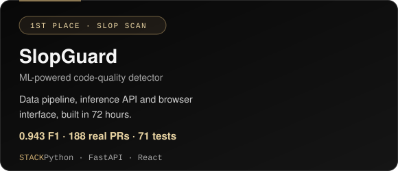
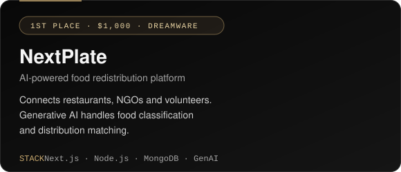
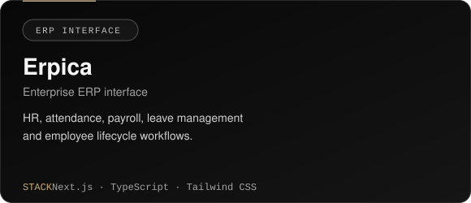
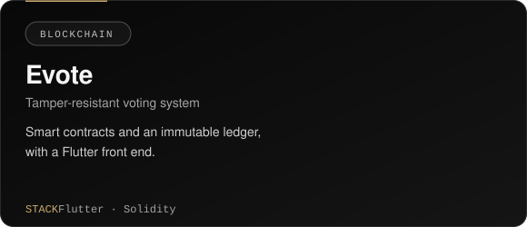
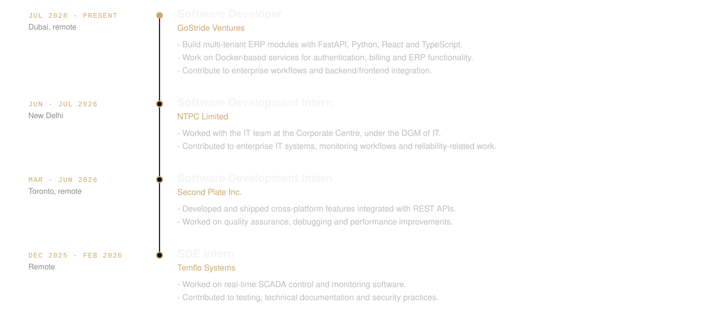
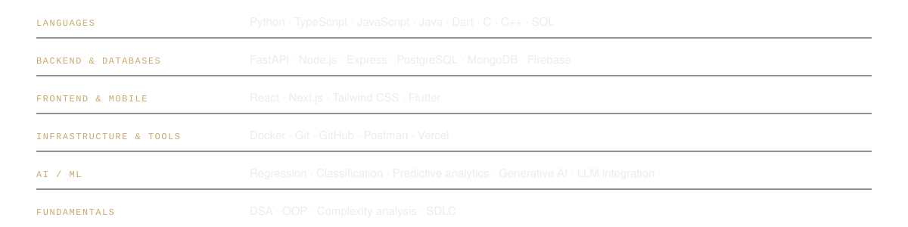
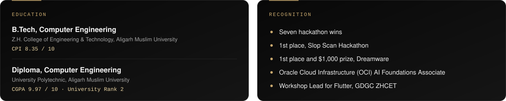

  
  
  
  

I'm a backend and full-stack developer working on multi-tenant ERP systems, Docker-based services and AI-powered applications, with cross-platform mobile work in Flutter. Currently a Software Developer at GoStride Ventures (Dubai, remote), based in Aligarh, India.

 

  
  

  
  

[SlopGuard live demo](https://slopguard-six.vercel.app/) · [NextPlate live demo](https://next-plate-core-1dha-beryl.vercel.app/story.html) · [Evote source](https://github.com/urjitupadhya/online_voting_system)

 

 

 

 

Interested in software engineering, backend systems, developer tools and practical AI applications.

[Portfolio](https://urjit-upadhyay-portfolio-updated-d5.vercel.app) · [LinkedIn](https://linkedin.com/in/urjit-upadhyay-049428236) · [Email](mailto:urjitupadhyayuu@gmail.com) · [GitHub](https://github.com/urjitupadhya)

Off the keyboard: bike rides, nature escapes and clean code. Currently curious about Web3 security and smart contracts.
